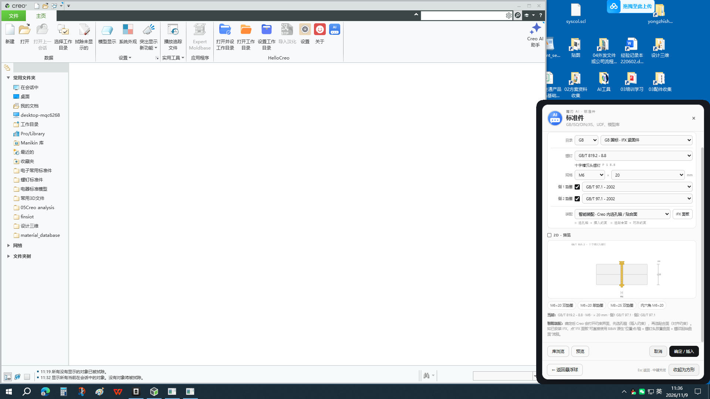

# 霜刃AI助手 (CreoAiAsk)

> 常驻在 PTC Creo Parametric 侧边的本地 AI 助手：用自然语言建模、出图、装配标准件、生成 BOM 与报价。
>
> 一个绿色便携的 Windows 工具，无需 JVM / Toolkit / Python 运行时。

<p align="center">
  
</p>

<p align="center">
  <a href="https://github.com/yzs00700/shuangren-ai-assistant">GitHub</a> ·
  <a href="https://gitee.com/hello-yong/shuangren-ai-assistant">Gitee</a> ·
  <a href="LICENSE">MIT License</a>
</p>

---

## 简介

**霜刃AI助手**（内部代号 CreoAiAsk）把一个大模型聊天窗口嵌到 Creo 的工作流里。它不是只回答问题的聊天框，而是可以真正驱动 Creo 的助手：

- 在同一个对话框里提问，或者直接说「新建零件」「画一个 M6 沉头孔」「生成 A4 图纸」；
- 通过本地 `CreoBridge` 调用 Creo 的 VB API，不依赖 JVM、Toolkit 或 Python；
- 所有临时文件、模型、图纸、BOM 和浏览器用户数据都留在软件目录内，可整包拷贝到其他电脑。

适配版本：**PTC Creo Parametric 13.4.1.0**（Windows 10 / 11 64 位）。

📄 详细文档：[安装说明](docs/安装说明.txt) · [使用说明](docs/使用说明.txt) · [发布说明](docs/发布说明.txt)

## 界面预览

<p align="center">
  
</p>

启动后 Creo 功能区会出现「AI」组和蓝色「AI助手」大按钮；也可以按 `a` 再按 `i`（`aiask` 映射键）打开。

## 功能特性

### AI 对话与 Creo 操作
- 可收起的悬浮球 / 聊天窗口（480 × 760），常驻 Creo 旁边。
- 自然语言执行 Creo 命令：新建 / 打开模型、拉伸、旋转、孔、倒圆角、倒角、阵列、镜像、拔模、抽壳、工程图视图、标注、重生成等。
- 命令搜索与执行、模型信息查询、当前模型上下文感知。
- 本地 `CreoAiSrv` 代理，兼容 DeepSeek / OpenAI Chat Completions 接口。

### 标准件 / UDF / 模型库
- 内置 GB 标准件检索与插入（GB/T 819.2、GB/T 97.1 等），支持十字槽沉头螺钉、垫圈、内外六角等组合。
- 包内 UDF 库（88 个）：孔、圆角、拔模、凸台、键槽、退刀槽等常用特征。
- 本地模型库，按自制件 / 外购件（MISUMI、Bosch Rexroth、item、Festo、SMC、THK、HIWIN 等）分类。
- 插入前可预览二维简图与规格，支持 IFX 智能装配。

### 工程图与导出
- HelloCreo GB 图框模板：A4 / A3 / A2 / A1 / A0 横向，A4 纵向。
- 手动布置视图、标注、技术要求库（通用 / 零件图、装配图、PCB、LED 灯板、塑料、钣金、压铸、铸造、玻璃、铝型材、CNC、线材、硅橡胶、自定义）。
- 图纸检查、PDF 导出。
- 三维导出：3D PDF（自动触发 Creo F10，带零件列表 / 注解 / 视图）与 STEP，统一保存到 `work\三维`。

### 铝型材框架
- 按参数自动生成铝型材框架。
- 生成后自动做结构快速校核，支持 6063 自制型材。

### BOM 与报价
- 多品类 BOM 报价：塑料、钣金、铝型材、铸造、CNC、3D 打印、电器、紧固件、线材、其他。
- 产品 BOM 表：公司抬头 / LOGO、BOM 名称、产品名称 / 型号、编制 / 校对 / 审核、版本、日期、修改记录、层级、类别、缩图、材料、表面处理、颜色、数量、单重 / 总重、已出图、轮廓尺寸、备注。
- 支持 E-BOM / P-BOM 的 CSV / JSON、正式 Excel 导出、导入报价、模型内嵌预览缩略图、Excel 式单元格复制粘贴 / 下拉填充、撤销重做。
- 报价单与 BOM 同款抬头（客户 / 项目 / 报价单号 / 有效期），导出含明细、费用汇总、含税总价、报价说明、修订记录和签章栏的正式 Excel。
- 地区费率 / 网价同步，BOM「保存」写入当前 Creo 模型所在目录，文件名为 `<模型名>_BOM_日期.json`。

## 系统要求

| 项目 | 要求 |
| --- | --- |
| 操作系统 | Windows 10 / 11 64 位 |
| Creo | PTC Creo Parametric 13.4.1.0 |
| 浏览器内核 | Microsoft Edge WebView2 Runtime |
| 可选依赖 | HelloCreo（GB 图框 / 自动出图相关功能需要，需自行安装并授权） |
| 大模型 | DeepSeek 或任意兼容 OpenAI Chat Completions 的服务 |

## 快速开始

> 本仓库包含源码、页面、配置模板和文档，**不包含** `*.exe`、`*.dll`、`host` 运行库以及 `temp` / `work` 等生成物。要直接运行，请使用完整绿色包。

1. 把完整绿色包解压到**非 C: 盘、路径无空格**的目录，例如 `D:\CreoAiAsk_Green_v12`。
2. 关闭所有 Creo 窗口。
3. 双击 `Setup.bat`（只需运行一次）。它会：
   - 只读方式读取机器上的 `config.pro`，生成本包自己的 `config.pro`；
   - 复制 GB 图框 / 笔表 / 字体映射到 `config\`；
   - 写入 HelloCreo 的 `protkdat`、`search_path` 和 `ai_hc_*` 映射键；
   - 把 `pro_group_dir` 指向包内 `UDF\`；
   - 安装功能区按钮与 `aiask` 映射键；
   - 创建 `work\models`、`work\frames`、`temp`、`backup`。
4. 以后每次双击 `start_creo_ai.bat` 启动 Creo + AI 窗口。
5. 打开 AI 设置，填入自己的 API Key（见下一节）。

> 不要用旧的 Creo 桌面快捷方式启动，否则读不到包内的 `config.pro`、`Mapkeys.pro` 和 AI 功能区按钮。

## 配置 API Key

```powershell
Copy-Item ai_config.example.ini ai_config.ini
notepad ai_config.ini
```

```ini
endpoint=https://api.deepseek.com/chat/completions
model=deepseek-chat
api_key=你的密钥
timeout_sec=120
```

保存后重启 `CreoAiSrv.exe`（或重新运行 `start_creo_ai.bat`）。也可以直接在 AI 窗口的设置页里填写。

**本仓库不包含任何真实 API Key。** `ai_config.ini` 已被 `.gitignore` 排除。

## 目录结构

```text
CreoAiAsk_Green_v12/
├─ app/                 # 聊天页、BOM / 报价页、STEP 解析内核（HTML/CSS/JS）
├─ bridge/              # CreoBridge 本地桥接（二进制不纳入仓库）
│  └─ data/             # 库索引
├─ host/                # 悬浮球宿主与 WebView2 运行库（不纳入仓库）
├─ src/
│  ├─ orbhost/          # 悬浮球宿主 C# 源码
│  └─ bomtree/          # BOM 树工具 C# 源码
├─ jlink/               # Creo 集成：Setup 脚本、功能区 UI、启动器
├─ config/              # Creo 绘图配置、GB 图框、笔表、字体映射
├─ templates/           # GB 工程图模板（.drw）
├─ UDF/                 # 88 个 Creo UDF
├─ models/              # 模型库目录占位（供应商模型需自行放入）
├─ stdlib/              # 标准件目录说明
├─ docs/                # README 图片
├─ Setup.bat            # 首次安装
├─ start_creo_ai.bat    # 日常启动
├─ Uninstall.bat        # 卸载 / 清理
└─ ai_config.example.ini
```

启动后的相关进程：

- `CreoAiSrv.exe` — 本地 AI 代理（默认对接大模型 API）
- `CreoBridge.exe` — Creo VB API 桥接 + 本地网页服务，端口 `18766`
- `AiAsk.exe` — AI 窗口宿主（由启动脚本拉起）
- `CreoToolbox.exe` / `BomTree.exe` — 命令与 BOM 辅助工具

## 绿色 / 便携说明

- 包内 `config.pro`、`Mapkeys.pro` 由 `Setup.bat` 按当前路径生成；移动或复制到别的电脑后需重新运行 `Setup.bat`。
- 机器上 `C:` 的 `config.pro` 只读，不会被修改。
- 临时文件、Edge 用户数据、模型、图纸、PDF、BOM 全部在包内。
- Edge 浏览器本体由 Windows 安装在 C:，但用户数据目录指向包内 `temp\edge_profile`。

## 本仓库包含 / 不包含

**包含**

- Web 前端（`app/`）、C# 源码（`src/`）、Creo 集成脚本（`jlink/`）
- Creo 配置、GB 图框、模板、UDF、模型库目录说明
- 使用 / 安装 / 发布文档
- 示例配置（不含密钥）

**不包含**

- `*.exe`、`*.dll`、`*.pdb` 等二进制
- `host/`（WebView2 运行库与宿主构建产物）
- `temp/`、`work/`、`backup/`、日志、`temp\edge_profile`
- 任何真实 API Key、个人路径配置
- HelloCreo 安装文件与授权
- 第三方供应商模型（仅保留目录占位与 README）

## 隐私与安全

- 聊天内容会发送到你配置的大模型接口；请自行评估数据敏感性。
- API Key 只保存在本机 `ai_config.ini`，不会写入仓库。
- 桥接服务仅监听本机 `127.0.0.1:18766`，请勿将该端口暴露到公网。

## 常见问题

**Q：功能区看不到「AI助手」按钮？**
确认是用 `start_creo_ai.bat` 启动的 Creo；必要时关闭 Creo 后重新运行 `Setup.bat`。

**Q：图纸打不开 / 导出失败？**
确认已安装 HelloCreo，并且 `config.pro` 中的 `protkdat`、`search_path` 指向本机实际路径。

**Q：换电脑后映射键失效？**
复制整个包后重新运行 `Setup.bat`，它会按新路径重写 `Mapkeys.pro` 与 `config.pro`。

## 许可证

[MIT License](LICENSE) © 2026 yzs00700

## 商标声明

PTC、Creo、Creo Parametric 是 PTC Inc. 的商标或注册商标；HelloCreo 归其各自所有者所有。本项目为个人开发项目，与 PTC、HelloCreo 官方无隶属或背书关系。

---

<sub>English: Shuangren AI Assistant (CreoAiAsk) is a local AI copilot for PTC Creo Parametric. It drives modeling, drawing, standard-part insertion, BOM and quotation workflows through natural language. This repository contains source code, web UI, Creo integration scripts and configuration templates only — no binaries or secrets.</sub>
